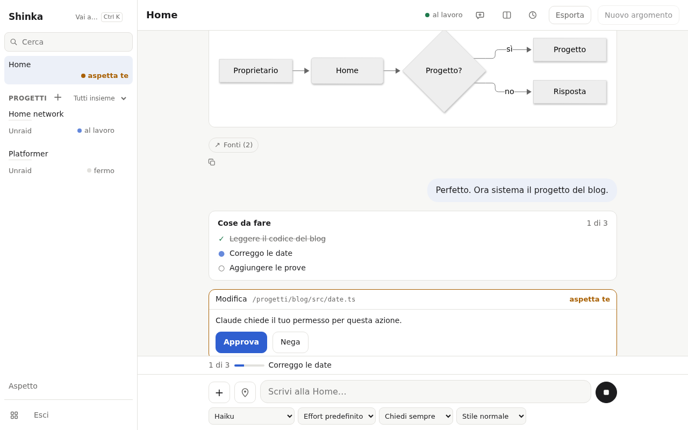
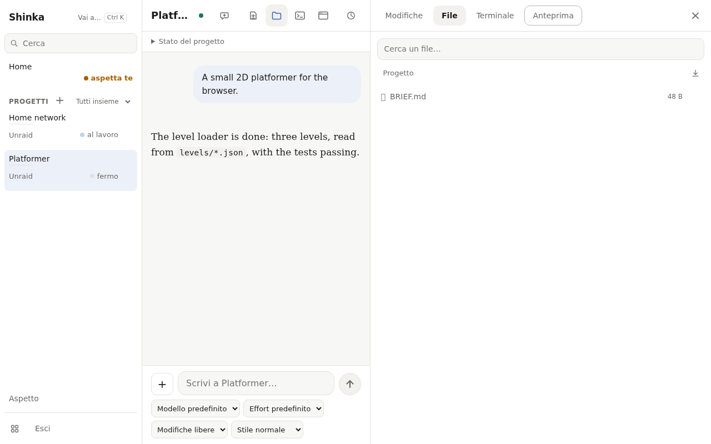
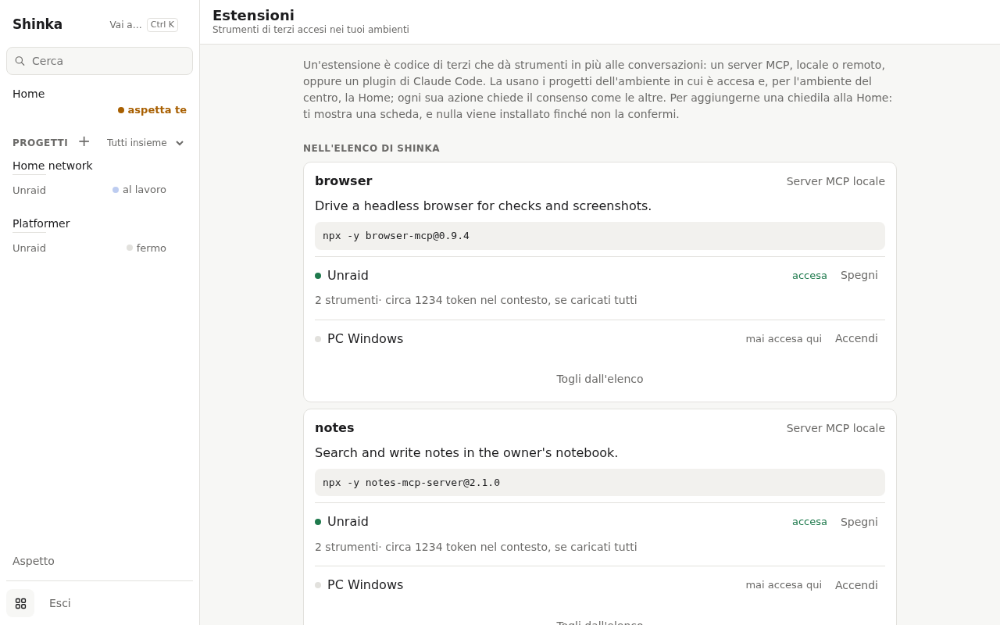
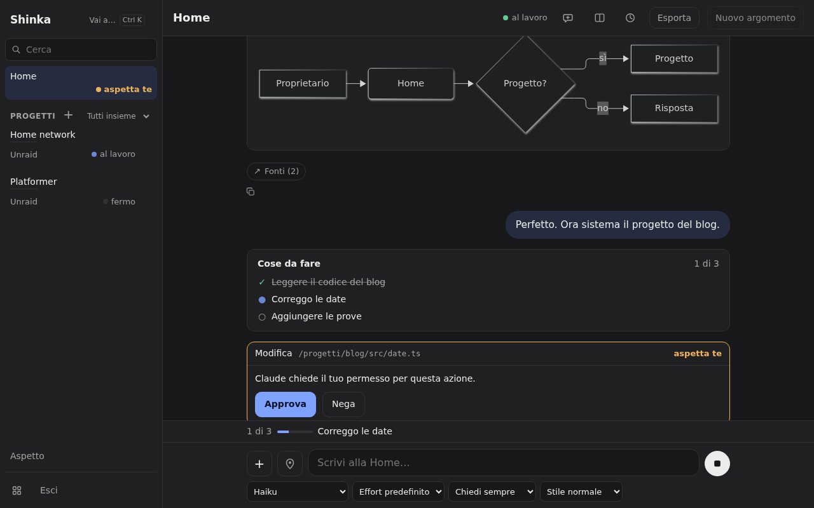
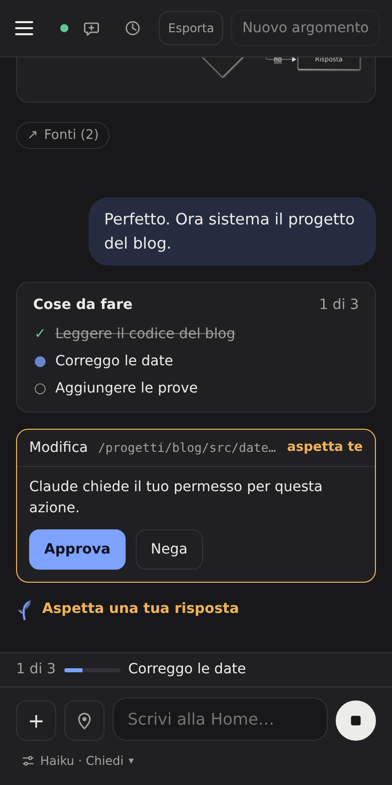
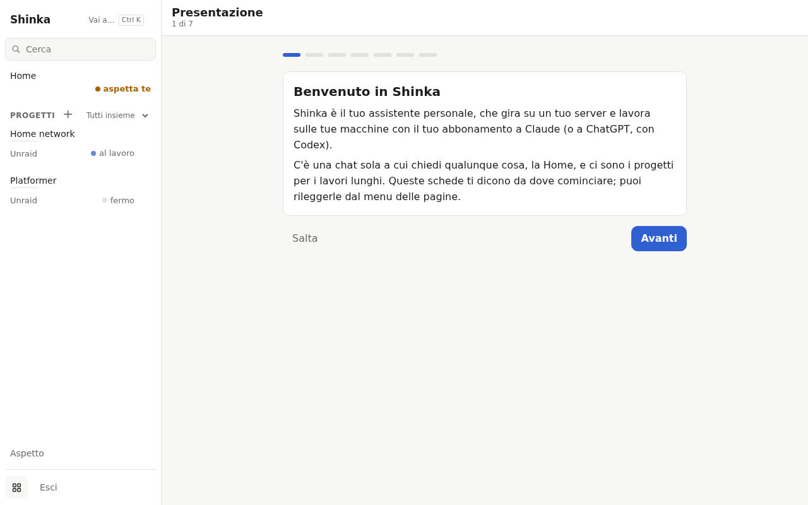

# Shinka

*Multi node agent harness.*

Shinka is a personal, self-hosted web app built around a single chat, the **Home**, where you ask for
anything. The Home answers, does on its own the jobs that fit in one sitting, and proposes a **project**
for the long ones. Each project lives in an **environment** (your server, a Windows PC, another Linux box)
with its own folder, Git repository, conversation, terminal and app preview. The conversations run on
Claude Code or Codex, with your own subscription.

It is meant for one owner on a home server, and it develops itself: new pieces are written by a Shinka
project, and they go live only after every test passes and the owner approves them.

> The interface, the code and the documents are in Italian. This page is the only one in English.



## What it does

- **One chat for everything.** Ask the Home a question, a script, a document, an action on one of your
  machines. Each topic is archived with a title and a summary when you move on, and can be searched and
  reopened. Parallel chats open in tabs and work while the main one is busy. The Home is reachable from
  Telegram too, and runs **scheduled jobs** ("every morning, check the backups"), also triggered by events
  from other systems.
- **Projects for the long jobs.** A project has its folder and repository in one environment, and next to
  its chat the file changes of every turn (with undo), a file browser, up to four terminals and a live
  preview of its web app. It can hand the implementation to another model and review the result.
- **Environments.** Any Linux or Windows machine joins with a one-line command and an approval. Its page
  shows CPU, memory, disk, processes (with the ones Shinka started, per project, and a way to stop them)
  and Docker containers. On Windows the node has a tray icon and can start with Windows.
- **Extensions.** MCP servers (local or remote), Claude Code plugins from a Git repository, and **local
  models**: an Anthropic-compatible server such as llama-server with Qwen on a GPU, started on demand and
  stopped when idle, usable by projects and, over the network with a key, by the Home. **Interface
  extensions** add themes, pages and buttons written by the Home, with pages sandboxed from the rest.
  Nothing is installed until the owner confirms a card that shows exactly what runs.
- **Your secrets stay yours.** Passwords and keys live in a vault inside a separate gateway container:
  conversations use them by name and never see their value. Paying, changing passwords and deleting
  accounts are forbidden, always. Every action follows the permission mode the owner picks, chat by chat.
- **It develops itself.** Ask the Home for something Shinka lacks: once confirmed, the Shinka project
  writes it with its tests, a clean copy is built and tested, and the new version goes live only with the
  owner's approval, rolling back by itself if it does not start.
- **Shinka Desktop**, a Windows client with local terminals, an offline copy of the conversations and
  automatic updates from the server, lives in its own repository.

| A project with its file panel | The extensions page |
|---|---|
|  |  |

| Dark theme | On the phone | The first-run tour |
|---|---|---|
|  |  |  |

The screenshots are taken with made-up data by `src/prove/schermate-readme.ts`.

## How it is built

| Part | Folder | What it does |
|---|---|---|
| Center (*centro*) | `src/centro` | The server: the interface, the Home, projects, topics, memory, skills, scheduled jobs. |
| Node (*nodo*) | `src/nodo` | Runs in every environment and drives the engine there: conversations, terminals, previews, local models. |
| Gateway | `src/gateway` | In its own container: keeps the vault, enforces the fixed prohibitions, runs the Telegram bot and the test stacks. |
| Guardian (*guardiano*) | `src/guardiano` | Keeps center, nodes and gateway running, and rolls back a version that does not start. |
| Interface | `web/src` | React, built with Vite; usable on a phone. |
| Protocol | `src/protocollo` | The messages between center, nodes and interface. |

The code is TypeScript that Node runs without compiling it. Names and comments are in Italian, using the
words of the glossary, and every piece has its test next to it.

## Where to read more

- [shinka.md](shinka.md): the specification. What it is, the domain rules, the architecture, the acceptance tests.
- [GLOSSARY.md](GLOSSARY.md): the project's vocabulary. Code and documents use these words.
- [docs/adr/](docs/adr/): the decisions that matter, one per file, with their reasons.
- [installazione/LEGGIMI.md](installazione/LEGGIMI.md): how to install the package one Shinka installation prepares for another.

The development log (`STATO.md`, referenced by the specification) is not in this copy: it also describes
the owner's own installation.

## Working on it

Node 22.18 or newer.

```bash
npm ci
npm run typecheck
npm test
npm run costruisci   # the interface
npm run avvia        # the center, on port 7850
```

## This copy

This repository is the public copy of Shinka, kept up to date by the project itself, one commit per piece.
Its history starts from the first publication; the earlier one stays on the server Shinka is installed from
([ADR 0044](docs/adr/0044-la-copia-pubblica-su-github.md)).

## License

[MIT](LICENSE).
